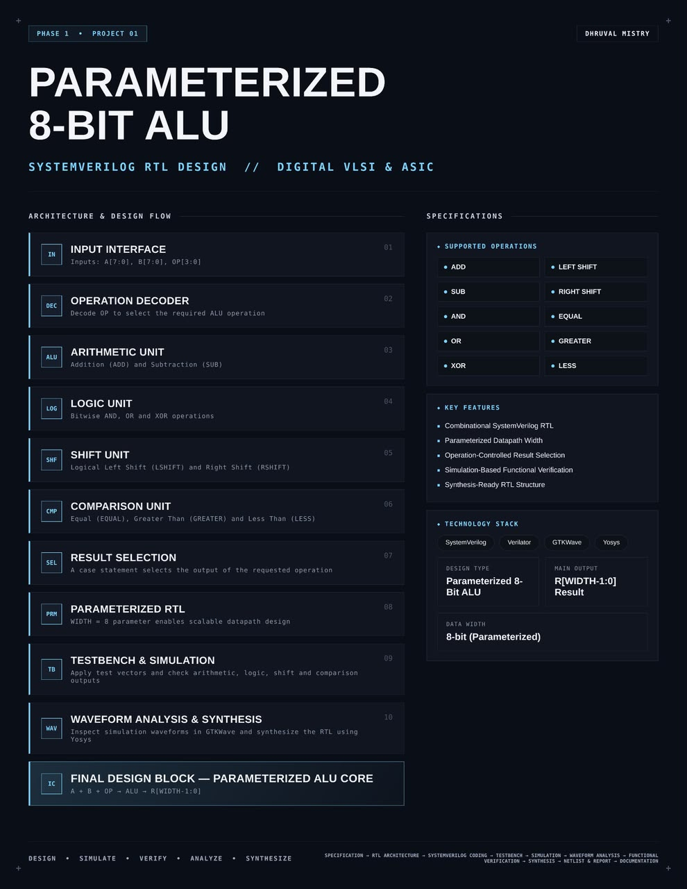
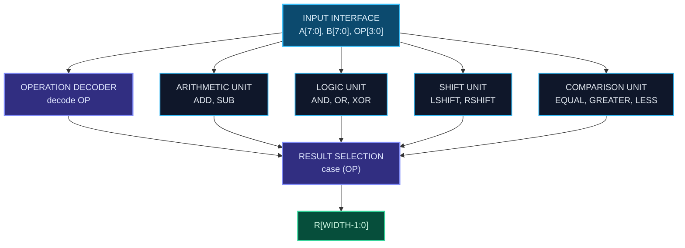
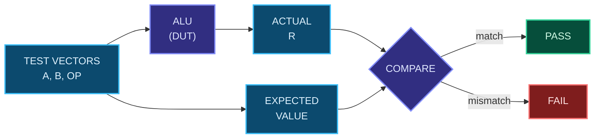

<div align="center">




<b>A synthesis-ready, parameterized Arithmetic Logic Unit with 10 operations, verified by simulation and synthesized with Yosys.</b>

<br/>


-38bdf8?style=flat-square&labelColor=0a0e17)


<br/>

[Overview](#overview) |
[At a Glance](#project-at-a-glance) |
[Background](#background-what-is-an-alu) |
[Operations](#supported-operations) |
[Architecture](#architecture) |
[Functional Description](#functional-description) |
[Interface](#interface) |
[Parameterization](#parameterization) |
[How It Works](#how-it-works) |
[Getting Started](#getting-started) |
[Verification](#verification) |
[Synthesis](#synthesis) |
[Applications](#applications) |
[FAQ](#faq) |
[License](#license)

</div>

---

## Overview

This project implements a **parameterized 8-bit Arithmetic Logic Unit (ALU)** in **SystemVerilog**.

The ALU takes two operands `A` and `B` and a 4-bit operation code `OP`. It decodes the opcode, routes the operands through the matching functional unit (arithmetic, logic, shift or comparison) and returns the output on `R[WIDTH-1:0]`. The datapath width is controlled by a single parameter, `WIDTH` (default `8`), so the same RTL scales to other bit widths without edits.

The design is purely **combinational**, written in a **synthesis-friendly** style, simulated with **Verilator**, inspected in **GTKWave** and synthesized with **Yosys**.

<table>
<tr>
<td width="50%" valign="top">

#### Objectives
- Design a clean, reusable ALU core in SystemVerilog
- Make the datapath width configurable
- Support arithmetic, logic, shift and comparison operations
- Verify every operation with directed test vectors
- Inspect behavior through waveform analysis
- Produce a synthesized gate-level netlist and report

</td>
<td width="50%" valign="top">

#### Key Features
- Combinational SystemVerilog RTL
- Parameterized datapath width
- 10 operations across 4 functional units
- Operation-controlled result selection
- Simulation-based functional verification
- Waveform-based debug and analysis
- Synthesis-ready RTL structure
- Fully open-source toolchain

</td>
</tr>
</table>

---

## Project at a Glance

| Attribute | Detail |
|:--|:--|
| **Design type** | Parameterized 8-bit ALU |
| **Description language** | SystemVerilog (RTL) |
| **Logic style** | Combinational |
| **Data width** | 8-bit, configurable through `WIDTH` |
| **Inputs** | `A[WIDTH-1:0]`, `B[WIDTH-1:0]`, `OP[3:0]` |
| **Main output** | `R[WIDTH-1:0]` |
| **Operations** | 10 (2 arithmetic, 3 logic, 2 shift, 3 comparison) |
| **Functional units** | 4 (arithmetic, logic, shift, comparison) |
| **Simulation** | Verilator |
| **Waveform analysis** | GTKWave |
| **Synthesis** | Yosys |
| **License** | MIT |

---

## Background: What is an ALU?

An **Arithmetic Logic Unit (ALU)** is the combinational digital circuit at the heart of a processor datapath. It performs integer arithmetic, bitwise logic, shifts and comparisons on binary operands. A control input selects which operation is performed, and the result is passed on to registers, memory or other datapath blocks.

Every CPU, microcontroller and digital signal processing datapath contains one or more ALUs, which makes the ALU a fundamental building block in digital VLSI and ASIC design. Designing one covers the core skills of RTL design: parameterization, decoding, datapath structure, verification and synthesis.

---

## Supported Operations

| Unit | Operation | Expression | Description |
|:--|:--|:--|:--|
| **Arithmetic** | `ADD` | `A + B` | Binary addition |
| **Arithmetic** | `SUB` | `A - B` | Binary subtraction |
| **Logic** | `AND` | `A & B` | Bitwise AND |
| **Logic** | `OR` | `A \| B` | Bitwise OR |
| **Logic** | `XOR` | `A ^ B` | Bitwise exclusive OR |
| **Shift** | `LSHIFT` | `A << n` | Logical left shift |
| **Shift** | `RSHIFT` | `A >> n` | Logical right shift |
| **Comparison** | `EQUAL` | `A == B` | True when the operands are equal |
| **Comparison** | `GREATER` | `A > B` | True when `A` is greater than `B` |
| **Comparison** | `LESS` | `A < B` | True when `A` is less than `B` |

---

## Architecture

The ALU is organized as an input interface, an operation decoder, four parallel functional units and a result-selection stage. `A` and `B` feed every functional unit at the same time, and `OP` decides which unit's result reaches the output.

#### Block diagram

```text
            +---------------------+
 A[7:0] --->|  ARITHMETIC UNIT    |---+
            |  ADD, SUB           |   |
            +---------------------+   |
            +---------------------+   |      +--------------------+
 B[7:0] --->|  LOGIC UNIT         |---+----->|  RESULT SELECTION  |----> R[WIDTH-1:0]
            |  AND, OR, XOR       |   |      |  case (OP)         |
            +---------------------+   |      +--------------------+
            +---------------------+   |                ^
 (A and B   |  SHIFT UNIT         |---+                |
  feed all  |  LSHIFT, RSHIFT     |   |        +-----------------+
  units)    +---------------------+   |        |   OPERATION     |
            +---------------------+   |        |   DECODER       |
            |  COMPARISON UNIT    |---+        +-----------------+
            |  EQUAL, GT, LT      |                     ^
            +---------------------+                     |
                                                    OP[3:0]
```

#### Data flow



#### Block breakdown

| # | Block | Role |
|:-:|:--|:--|
| `01` | **Input Interface** | Accepts `A[7:0]`, `B[7:0]` and `OP[3:0]` |
| `02` | **Operation Decoder** | Decodes `OP` to select the required ALU operation |
| `03` | **Arithmetic Unit** | Addition (`ADD`) and subtraction (`SUB`) |
| `04` | **Logic Unit** | Bitwise `AND`, `OR` and `XOR` |
| `05` | **Shift Unit** | Logical left shift (`LSHIFT`) and right shift (`RSHIFT`) |
| `06` | **Comparison Unit** | Equal (`EQUAL`), greater than (`GREATER`) and less than (`LESS`) |
| `07` | **Result Selection** | A `case` statement selects the output of the requested operation |
| `08` | **Parameterized RTL** | `WIDTH = 8` parameter enables a scalable datapath |
| `09` | **Testbench & Simulation** | Applies test vectors and checks arithmetic, logic, shift and comparison outputs |
| `10` | **Waveform Analysis & Synthesis** | Inspects waveforms in GTKWave and synthesizes the RTL with Yosys |

> **Final design block:** `A + B + OP -> ALU -> R[WIDTH-1:0]`

---

## Functional Description

#### Arithmetic unit
Performs addition (`ADD`) and subtraction (`SUB`) of `A` and `B`. The result is `WIDTH` bits wide.

#### Logic unit
Performs bitwise `AND`, `OR` and `XOR` between `A` and `B`. Each result bit depends only on the bits at the same position in the two operands.

| `A` bit | `B` bit | `AND` | `OR` | `XOR` |
|:-:|:-:|:-:|:-:|:-:|
| 0 | 0 | 0 | 0 | 0 |
| 0 | 1 | 0 | 1 | 1 |
| 1 | 0 | 0 | 1 | 1 |
| 1 | 1 | 1 | 1 | 0 |

#### Shift unit
Performs a logical left shift (`LSHIFT`) and a logical right shift (`RSHIFT`). Logical shifts fill the vacated bit positions with zeros.

#### Comparison unit
Compares `A` and `B` and reports whether they are equal (`EQUAL`), whether `A` is greater (`GREATER`) or whether `A` is smaller (`LESS`).

#### Result selection
The outputs of all four units are available at the same time. A `case` statement on `OP` selects the result of the requested operation and drives it onto `R[WIDTH-1:0]`.

---

## Interface

#### Parameters

| Parameter | Default | Description |
|:--|:-:|:--|
| `WIDTH` | `8` | Datapath width in bits. Controls the width of `A`, `B` and `R`. |

#### Ports

| Port | Direction | Width | Description |
|:--|:-:|:-:|:--|
| `A` | Input | `[WIDTH-1:0]` | First operand |
| `B` | Input | `[WIDTH-1:0]` | Second operand |
| `OP` | Input | `[3:0]` | Operation select code |
| `R` | Output | `[WIDTH-1:0]` | Result of the selected operation |

The design is combinational, so it has no clock or reset port. `R` updates whenever `A`, `B` or `OP` changes.

#### Opcode map

| Operation | `OP[3:0]` |
|:--|:-:|
| `ADD` | `TBD` |
| `SUB` | `TBD` |
| `AND` | `TBD` |
| `OR` | `TBD` |
| `XOR` | `TBD` |
| `LSHIFT` | `TBD` |
| `RSHIFT` | `TBD` |
| `EQUAL` | `TBD` |
| `GREATER` | `TBD` |
| `LESS` | `TBD` |

---

## Parameterization

The `WIDTH` parameter sets the size of `A`, `B` and `R` in one place, so the whole datapath scales together.

| `WIDTH` | Operand size | Unsigned operand range |
|:-:|:--|:--|
| `8` (default) | 8-bit | `0` to `255` |
| `16` | 16-bit | `0` to `65,535` |
| `32` | 32-bit | `0` to `4,294,967,295` |

Override it when instantiating the ALU:

```systemverilog
alu #(.WIDTH(16)) u_alu16 (.A(a), .B(b), .OP(op), .R(r));
```

---

## How It Works

1. **Apply inputs.** The operands `A` and `B` and the opcode `OP` are driven onto the input interface.
2. **Decode.** The operation decoder reads `OP` and identifies the requested operation.
3. **Compute.** The arithmetic, logic, shift and comparison units evaluate their operations on `A` and `B`.
4. **Select.** A `case` statement on `OP` passes the result of the requested operation to the output.
5. **Output.** The selected value appears on `R[WIDTH-1:0]`.

#### Worked example

Expected results for `A = 25` (`8'b0001_1001`) and `B = 10` (`8'b0000_1010`):

| Operation | Expected result |
|:--|:--|
| `ADD` | `35` (`8'b0010_0011`) |
| `SUB` | `15` (`8'b0000_1111`) |
| `AND` | `8` (`8'b0000_1000`) |
| `OR` | `27` (`8'b0001_1011`) |
| `XOR` | `19` (`8'b0001_0011`) |
| `EQUAL` | false |
| `GREATER` | true |
| `LESS` | false |

---

## Repository Structure

```text
parameterized-8-bit-alu/
├── rtl/
│   └── alu.sv              # Parameterized ALU core
├── tb/
│   └── alu_tb.sv           # Self-checking testbench
├── sim/
│   └── waves.vcd           # Generated waveform dump
├── synth/
│   ├── synth.ys            # Yosys synthesis script
│   ├── alu_netlist.v       # Gate-level netlist
│   └── synth_report.txt    # Yosys stat report
├── LICENSE
└── README.md
```

---

## Technology Stack

| Tool | Role in this project |
|:--|:--|
|  | RTL design and testbench |
|  | Compiles and simulates the design |
|  | Views the simulation waveforms |
|  | Synthesizes the RTL to a gate-level netlist |

---

## Getting Started

#### Prerequisites

| Tool | Purpose | Version |
|:--|:--|:--|
| Verilator | RTL simulation | 5.x or later |
| GTKWave | Waveform viewer | Any recent |
| Yosys | RTL synthesis | Any recent |

```bash
# Ubuntu / Debian
sudo apt update
sudo apt install verilator gtkwave yosys
```

#### 1. Clone

```bash
git clone https://github.com/dhruvalmistry2007/parameterized-8-bit-alu.git
cd parameterized-8-bit-alu
```

#### 2. Simulate

```bash
verilator --binary --trace -Wall --top-module alu_tb rtl/alu.sv tb/alu_tb.sv
./obj_dir/Valu_tb
```

#### 3. View waveforms

```bash
gtkwave sim/waves.vcd
```

#### 4. Synthesize

```bash
yosys -p "read_verilog -sv rtl/alu.sv; synth -top alu; stat; write_verilog synth/alu_netlist.v"
```

---

## Verification

The testbench applies test vectors to the ALU and checks the outputs of every functional unit. Results are then inspected as waveforms in GTKWave.



#### Test plan

| Unit | Scenario | Example inputs | Expected (8-bit, unsigned) |
|:--|:--|:--|:--|
| Arithmetic | Normal addition | `25 + 10` | `35` |
| Arithmetic | Wrap-around on overflow | `255 + 1` | `0` |
| Arithmetic | Normal subtraction | `25 - 10` | `15` |
| Arithmetic | Wrap-around on underflow | `10 - 25` | `241` |
| Logic | Mixed bit patterns | `25 & 10`, `25 \| 10`, `25 ^ 10` | `8`, `27`, `19` |
| Logic | All zeros and all ones | `0` and `255` | Per truth table |
| Shift | Zero fill on vacated bits | Left and right shift of `A` | Zeros shifted in |
| Comparison | Equal operands | `A = B` | `EQUAL` true |
| Comparison | `A` greater than `B` | `25` vs `10` | `GREATER` true |
| Comparison | `A` less than `B` | `10` vs `25` | `LESS` true |
| Comparison | Boundary values | `0` vs `255` | `LESS` true |

#### Coverage matrix

| Unit | Operations checked | Result |
|:--|:--|:-:|
| Arithmetic | `ADD`, `SUB` | `TBD` |
| Logic | `AND`, `OR`, `XOR` | `TBD` |
| Shift | `LSHIFT`, `RSHIFT` | `TBD` |
| Comparison | `EQUAL`, `GREATER`, `LESS` | `TBD` |

#### Waveform analysis checklist

| Signal | What to confirm |
|:--|:--|
| `OP` | Each opcode is applied in turn |
| `A`, `B` | Operand values change as the test vectors are applied |
| `R` | Output matches the expected value for the active `OP` |
| Switching | `R` updates as soon as an input changes, with no clock needed |

---

## Synthesis

The RTL is synthesized with **Yosys**. The flow reads the SystemVerilog source, elaborates the design hierarchy, maps it to generic logic cells, prints a cell statistics report and writes the gate-level netlist. The netlist and the report are stored in [`synth/`](synth/).


| Step | Command | Purpose |
|:--|:--|:--|
| Read | `read_verilog -sv` | Loads the SystemVerilog RTL |
| Synthesize | `synth -top alu` | Elaborates and maps the design to generic gates |
| Report | `stat` | Prints cell and wire statistics |
| Export | `write_verilog` | Writes the gate-level netlist |

#### Results

| Metric | Value |
|:--|:-:|
| Top module | `alu` |
| Data width | `8` |
| Total cells | `TBD` |
| Wires / wire bits | `TBD` |
| Logic depth / critical path | `TBD` |
| Area | `TBD` |

---

## Design Considerations

| Aspect | Approach |
|:--|:--|
| **Logic style** | Purely combinational, with no clock, reset or internal state |
| **Scalability** | Single `WIDTH` parameter controls the whole datapath |
| **Structure** | Separate functional units merged by an operation-controlled `case` statement |
| **Synthesis** | Synthesis-ready RTL structure, targeting a Yosys flow |
| **Verification** | Simulation-based, with directed test vectors and waveform inspection |

#### Current limitations
- No status flags such as carry, overflow or zero
- No pipelining, so the output is a direct combinational function of the inputs
- Verified through simulation only, with no formal verification

---

## Applications

- Processor and microcontroller datapaths
- Embedded and SoC compute blocks
- DSP datapath building blocks
- FPGA and ASIC prototyping of arithmetic units
- Teaching and reference design for digital VLSI and RTL coding

---

## Customization

#### Change the datapath width

Override `WIDTH` when instantiating the ALU:

```systemverilog
alu #(.WIDTH(32)) u_alu32 (.A(a), .B(b), .OP(op), .R(r));
```

#### Add a new operation

1. Pick an unused `OP[3:0]` code and add it to the opcode map.
2. Implement the new operation in the matching functional unit.
3. Add the new case to the result-selection `case` statement.
4. Add test vectors for it in the testbench and re-run the simulation.

---

## Troubleshooting

| Problem | Likely cause | Fix |
|:--|:--|:--|
| `--binary` option not recognized | Verilator version is older than 5.x | Upgrade Verilator to 5.x or later |
| `waves.vcd` is not generated | Tracing is not enabled | Build with `--trace` and make sure the testbench calls `$dumpfile` and `$dumpvars` |
| Yosys cannot find the top module | `-top` name does not match the module name | Use the exact module name from `rtl/alu.sv` |
| Simulation fails to start | Testbench top name mismatch | Make sure `--top-module` matches the testbench module name |
| Unexpected result on `SUB` | Operand ordering or unsigned wrap-around | Check the `A - B` order and remember results wrap at `WIDTH` bits |

---

## FAQ

**Why is the ALU combinational?**
An ALU has no need to hold state, so a combinational design keeps the logic simple and lets the output follow the inputs directly.

**Why is the design parameterized?**
A single `WIDTH` parameter lets the same RTL serve 8, 16, 32-bit or any other datapath, with no code changes.

**Does it have carry or overflow flags?**
Not in this version. Status flags are listed under Future Work.

**Why Verilator, GTKWave and Yosys?**
They are free, open-source tools that cover simulation, waveform viewing and synthesis, so the whole project can be reproduced without licenses.

---

## Learning Outcomes

- Writing parameterized, synthesis-friendly SystemVerilog RTL
- Structuring a datapath with decoding and result selection
- Building a testbench with directed test vectors
- Debugging a design through waveform analysis
- Running RTL synthesis and reading the resulting reports

---

## Design Flow


<div align="center">

`DESIGN` | `SIMULATE` | `VERIFY` | `ANALYZE` | `SYNTHESIZE`

</div>

---

## Future Work

- Add carry, overflow and zero status flags
- Add arithmetic right shift and rotate operations
- Add a multiplier unit
- Add a registered (pipelined) output variant
- Add self-checking randomized tests
- Run the design through an RTL-to-GDSII flow (OpenLane)

---

## Contributing

Suggestions and improvements are welcome. Open an issue to discuss a change, or submit a pull request with a clear description of what it does and the simulation results that support it.

---

## References

- [Verilator](https://www.veripool.org/verilator/): open-source SystemVerilog simulator
- [GTKWave](https://gtkwave.sourceforge.net/): waveform viewer
- [Yosys Open SYnthesis Suite](https://yosyshq.net/yosys/): open-source RTL synthesis framework
- IEEE Std 1800: SystemVerilog language standard

---

## License

This project is licensed under the **MIT License**. See the [LICENSE](LICENSE) file for details.

---

## Author

<div align="center">

**Dhruval Mistry**

[](https://github.com/dhruvalmistry2007)

<br/>


</div>
